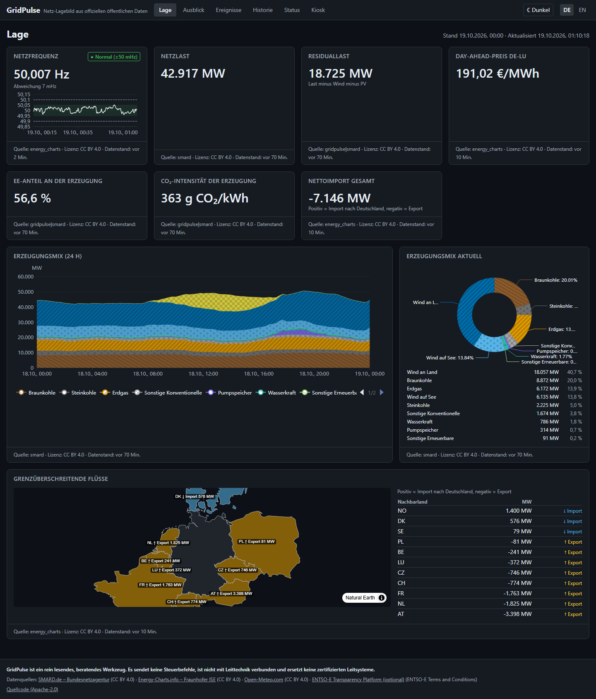
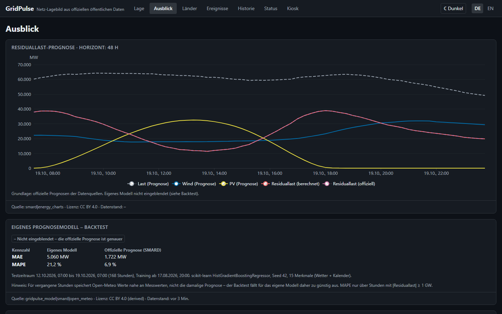
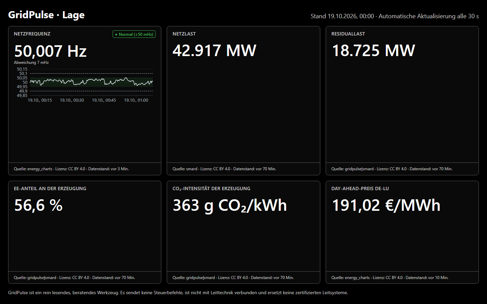

# GridPulse

**Open-source situational picture of the German and European power grid – built
exclusively from public, official data sources.**

[](https://github.com/NOGtechnologia/gridpulse/actions/workflows/ci.yml)
[](https://github.com/NOGtechnologia/gridpulse/actions/workflows/e2e.yml)
[-brightgreen)](docs/progress.md)
[](LICENSE)
[](https://securityscorecards.dev/viewer/?uri=github.com/NOGtechnologia/gridpulse)

> *"How is the grid doing right now, what is coming in the next 24–48 hours, and is
> anything unusual?"*



> [!WARNING]
> **Disclaimer:** GridPulse is a **read-only, advisory** tool. It sends no control
> commands, is not connected to SCADA/control systems and is **no substitute for
> certified control systems**.

## Quick start

```bash
git clone https://github.com/NOGtechnologia/gridpulse.git && cd gridpulse
cp .env.example .env
GRIDPULSE_DEMO=1 docker compose -f deploy/docker-compose.yml up -d   # offline demo data
# or with live data from SMARD and Energy-Charts:
docker compose -f deploy/docker-compose.yml up -d
```

Open <http://localhost:3000> (dashboard) and <http://localhost:8000/api/docs> (API).

## Features

| View | What it shows |
|---|---|
| **Lage** (situation) | grid frequency with traffic light (±50/±100 mHz) and 60-min sparkline, load, residual load, renewable share, CO₂ intensity, day-ahead price (negative prices marked), generation mix (stacked area + donut), cross-border flows on a map |
| **Ausblick** (outlook) | 48 h residual load from official forecasts, negative-price and dunkelflaute windows; own model with backtest metrics, shown only when it beats the official forecast ([forecasting](docs/forecasting.md)) |
| **Länder** (countries) | load and day-ahead price per bidding zone (Germany and neighbours) from ENTSO-E; needs `GRIDPULSE_ENTSOE_TOKEN`, otherwise explains how to enable it |
| **Ereignisse** (events) | deterministic rules (frequency, forecast error, price spikes, stale data), robust z-score/MAD anomalies, plausibility and source cross-check violations; webhook, Slack/Teams and e-mail notifications with debouncing |
| **Historie** (history) | free period, 15 min / 1 h / 1 day (Berlin calendar days), comparison of two periods, CSV/Parquet export with licence metadata |
| **Status** | per source: last success, latency, gap ratio, plausibility violations; Prometheus metrics |
| **Kiosk** | full-screen, high-contrast wall display with auto refresh |

Every number shows its **unit, data timestamp and source**; stale data is marked.
German and English UI, dark (default) and light theme, keyboard accessible,
colour-blind-safe carrier colours.

| Outlook | Kiosk |
|---|---|
|  |  |

## Data sources and licences

| Source | Content | Licence |
|---|---|---|
| [SMARD.de](https://www.smard.de) – Bundesnetzagentur | generation, load, forecasts, day-ahead prices | CC BY 4.0 |
| [Energy-Charts](https://www.energy-charts.info) – Fraunhofer ISE | generation, prices, cross-border flows, grid frequency | CC BY 4.0 |
| [Open-Meteo](https://open-meteo.com) | weather forecasts | CC BY 4.0 |
| [ENTSO-E Transparency Platform](https://transparency.entsoe.eu) (optional, token) | European load and prices | ENTSO-E T&C |

Attribution is carried in the UI footer of every tile, in every API response
(`meta.source`, `meta.license`) and in exports. See [NOTICE](NOTICE) and
[docs/data-sources.md](docs/data-sources.md) (verified endpoints and quirks).

## Architecture

Python 3.12 / FastAPI / SQLAlchemy 2 async / PostgreSQL 16 + TimescaleDB (hypertable,
continuous aggregates) / APScheduler worker / Pandera validation · Next.js 15,
TypeScript strict, Tailwind, ECharts, MapLibre (offline style), next-intl.
Details: [docs/architecture.md](docs/architecture.md), decisions: [docs/adr/](docs/adr/).

## Quality gate

`make check` runs exactly what CI runs:

```bash
make check     # lint typecheck test-unit test-integration test-frontend build security
make e2e       # Playwright (Chromium/Firefox/WebKit) + axe + visual regression; Lighthouse in CI
make verify-sources   # live check of all data sources (nightly in CI)
```

Enforced thresholds: ruff (incl. Bandit rules) and `mypy --strict` with 0 findings,
backend coverage ≥ 90 % and 100 % for `domain/` and `validation/`, Hypothesis
property tests (DST 23/25-h days), integration tests against a real TimescaleDB,
contract tests against recorded source responses, Schemathesis against the OpenAPI
schema, nightly mutation testing; ESLint strict, `tsc` strict, Vitest ≥ 80 %, axe
without serious/critical findings, Lighthouse ≥ 90/95/95; CodeQL, gitleaks,
pip-audit, pnpm audit, Trivy, Hadolint, licence checks, signed multi-arch images with
SBOM. Windows without make: `uv run --project backend python scripts/tasks.py check`.

### Branch protection

`main` only via pull request; required checks: `ci` (backend, frontend, security),
`e2e`, `codeql`, `docker`; linear history; no force pushes.

## Configuration and operations

Environment variables only – see [.env.example](.env.example).
Health: `/healthz`, `/readyz`; metrics: `/metrics`. Backups, retention and API keys:
[docs/operations.md](docs/operations.md). API: [docs/api.md](docs/api.md).

## Contributing

See [CONTRIBUTING.md](CONTRIBUTING.md), [CODE_OF_CONDUCT.md](CODE_OF_CONDUCT.md) and
[SECURITY.md](SECURITY.md) (please report vulnerabilities privately).

## Contact

Questions and ideas: GitHub Discussions/Issues of this repository. Security reports:
GitHub private vulnerability reporting.

## License

Code: [Apache-2.0](LICENSE). Data: licences of the respective providers (see above).
