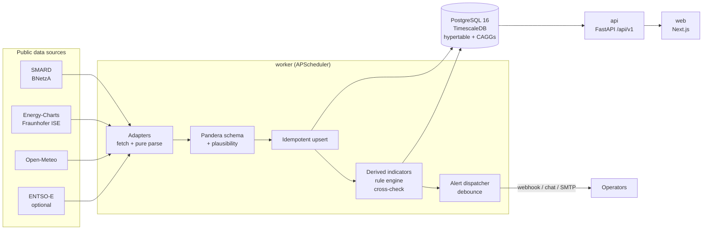
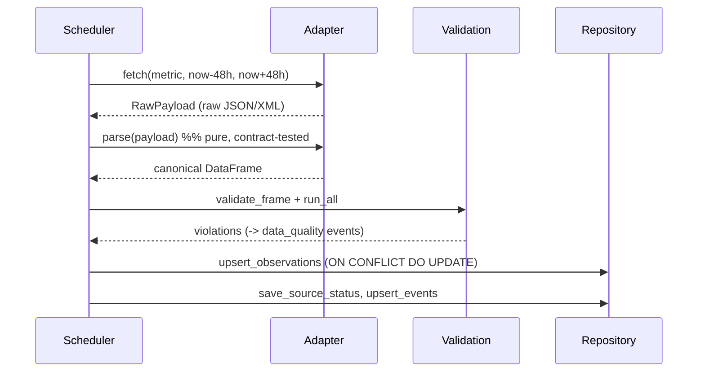

# Architecture

## Overview

* **worker** – fetches every source on its own schedule (15 min data, 1 min
  frequency, 60 min weather), validates, stores and evaluates rules every 5 min.
* **api** – read-only FastAPI application; every response carries
  `meta.source`, `meta.license`, `meta.attribution`.
* **web** – Next.js 15 (App Router). The browser only talks to the web origin;
  `/api/v1/*` is proxied server-side to `GRIDPULSE_API_URL` (no CORS, one image for
  every deployment).

## Data flow of one ingest run

Violations never drop data silently: the data is stored unchanged and each
violation becomes a `data_quality` event (spec 7.4). Schema failures (wrong
units, unknown metrics) are rejected and reported as `DATA-002`.

## Modules

| Package | Responsibility | Purity |
|---|---|---|
| `adapters/` | HTTP fetch with backoff + jitter, pure `parse()` | parse is pure |
| `domain/` | metrics catalogue, time handling, residual load, CO₂, indicators, rules, statistics | pure, 100 % coverage |
| `validation/` | Pandera schema, plausibility checks, cross-check | pure, 100 % coverage |
| `storage/` | `Repository` protocol, TimescaleDB + in-memory implementations, Alembic | I/O |
| `services/` | summary, forecast, analysis (glue between repository and domain) | I/O |
| `worker/` | job catalogue, ingest pipeline, scheduler, entry point | I/O |
| `alerts/` | channels and debouncing dispatcher | I/O |
| `api/` | FastAPI app, routes, rate limiter, API keys, export | I/O |

## Storage model

`observations` is a hypertable (7-day chunks, compressed after 7 days, segment by
metric/area/kind/source). Two continuous aggregates with real-time aggregation:

* `observations_1h` – hourly means (`time_bucket('1 hour', ts)`),
* `observations_1d` – daily means over **Europe/Berlin calendar days**
  (`time_bucket('1 day', ts, 'Europe/Berlin')`, 23 h / 25 h on DST days).

The API's `15min` resolution buckets the raw table on the fly, so the 10-second
frequency data can be read at any resolution.

## Decisions

See `docs/adr/` for the reasoning behind the main choices.
